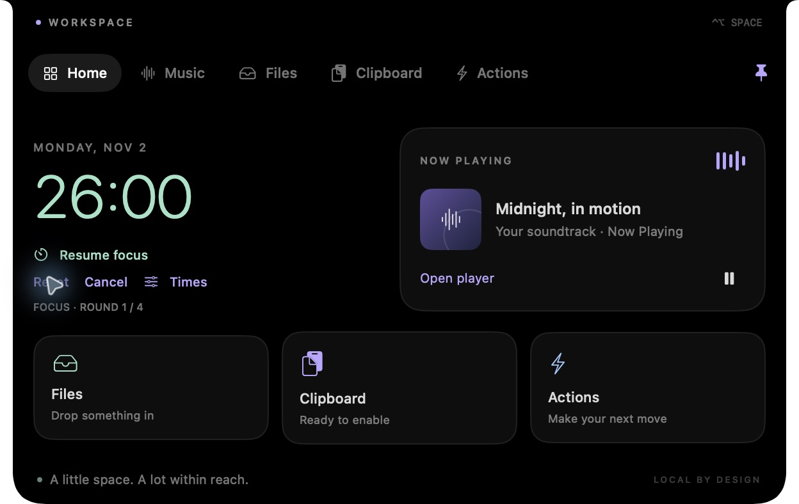
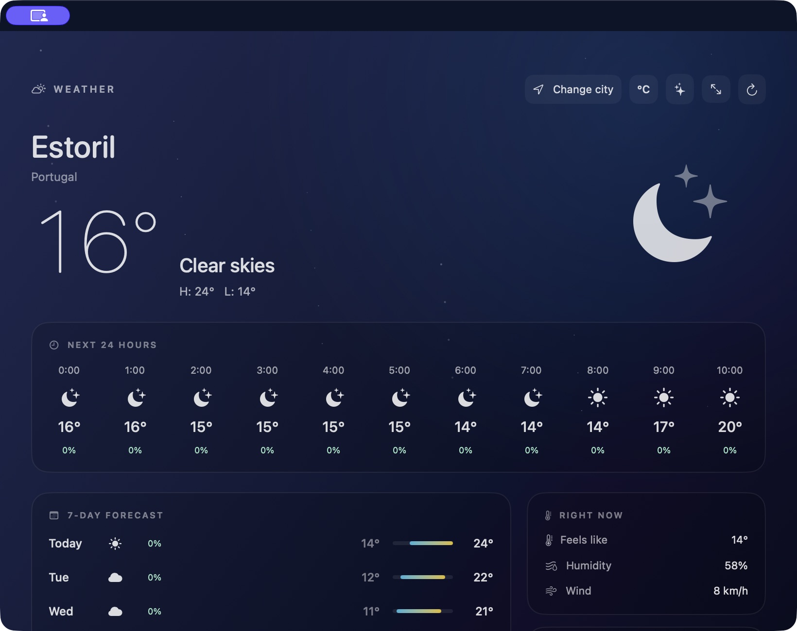

# Notch Workspace

A small, native Mac workspace that expands from the notch. Built from [Boring Notch](https://github.com/TheBoredTeam/boring.notch), with an independent lightweight AppKit/SwiftUI target.



## Get the app

Download **Notch.Workspace.zip** from [Releases](https://github.com/Sghibiri/notch-workspace/releases). Unzip it and move the app into Applications. This is an Apple silicon development build, locally signed and not notarized by Apple. Checked on macOS 27.2, with macOS 26 builds and checks in GitHub Actions.

Hover over the notch or press **Control–Option–Space**. Move away to close it, or pin it open. Its menu bar icon gives you another way in.

## Within reach

- **Weather:** live Estoril weather in the notch and an expanded native window. Includes animated weather across the whole window, full screen, hourly and seven-day forecasts, city search, and Celsius/Fahrenheit. Effects stop when the window is hidden, closed, or inactive, and respect reduced motion and Low Power Mode.
- **Music:** Now Playing artwork and metadata, play/pause, previous/next, and seeking.
- **Files:** a persistent drop shelf. Drag files in and back out; open, share, or reveal them in Finder. Originals are never moved or deleted.
- **Clipboard:** searchable history of up to 40 text copies, explicitly enabled, kept in memory, with pause and clear. History clears on quit or screen lock. If macOS blocks clipboard access, capture stops and the Clipboard tab explains how to review access.
- **Quick actions:** apps, websites, and existing Apple Shortcuts, plus Downloads, Screenshot, and System Settings.
- **Pomodoro:** focus and break times you can change, short and long breaks, configurable rounds, pause/resume, and optional automatic progression. **Reset** and **Cancel** are directly below the active timer. **Times** opens settings inside the notch; the panel remains anchored to the top of the display. The compact notch shows the countdown. Running and paused sessions survive app restarts; a session that ended while the app was closed advances once to a paused next phase.

## Built to stay small

No Electron, embedded browser, persistent server, account, or analytics. Weather requests go directly to Open-Meteo and use a 15-minute cache while a weather view is visible. Hover is event driven. Clipboard polling stops when capture is disabled. Pomodoro sleeps until its deadline instead of polling. The original project's optional camera/calendar/updater/XPC/animation packages are not linked into this target.

The app bundle is approximately **3.1 MB**. Resource measurements, test details, build instructions, and scope are documented in [Workspace/README.md](Workspace/README.md).



## Build and check

Requires a Mac with Swift and Apple's Command Line Tools; full Xcode is not required when the macOS 26 SDK is installed.

```sh
bash Workspace/Scripts/build.sh
"../Notch Workspace.app/Contents/MacOS/NotchWorkspace" --self-test
```

The build produces an app and zip archive beside the source folder. The 69 checks use temporary files, an isolated pasteboard, and synthetic data. A `--preview` argument opens a UI preview without monitoring music or clipboard contents or requesting real weather.

The custom application is in **Workspace/Sources**. The original Boring Notch Xcode project remains in this repository for reference, with its original [README](README.upstream.md). This target directly reuses its notch geometry and adapts its MediaRemoteAdapter integration.

## Status and credits

Early release. Hidden menu bar icons, phone calls, Bluetooth activities, notification interception, and third-party plugins are not included. DynamicLake's video informed the interaction direction; its proprietary code and branding are not part of this app.

GPL-3.0, with original Boring Notch credits retained. Includes MediaRemoteAdapter by Jonas van den Berg under BSD-3-Clause and notch geometry originally from Kai Azim's DynamicNotchKit under MIT. See [LICENSE](LICENSE) and [Workspace/NOTICE.md](Workspace/NOTICE.md).

Weather uses [Open-Meteo](https://open-meteo.com/) and its GeoNames-based city search. The chosen city and its public coordinates are sent to the provider; device location, clipboard, files, and contacts are not sent. Forecasts are cached locally. The public API is for non-commercial use; weather data is attributed under [CC BY 4.0](https://creativecommons.org/licenses/by/4.0/). See [provider terms](https://open-meteo.com/en/terms).
